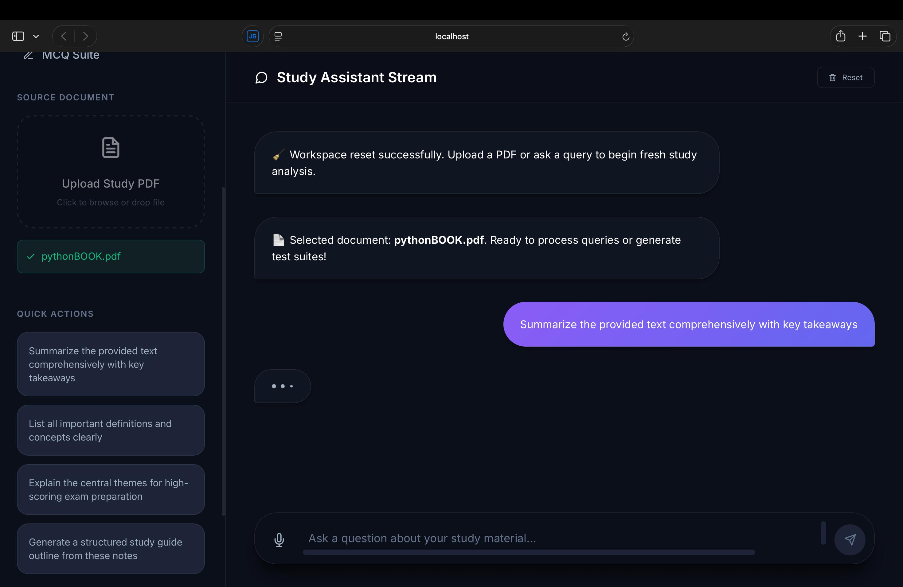
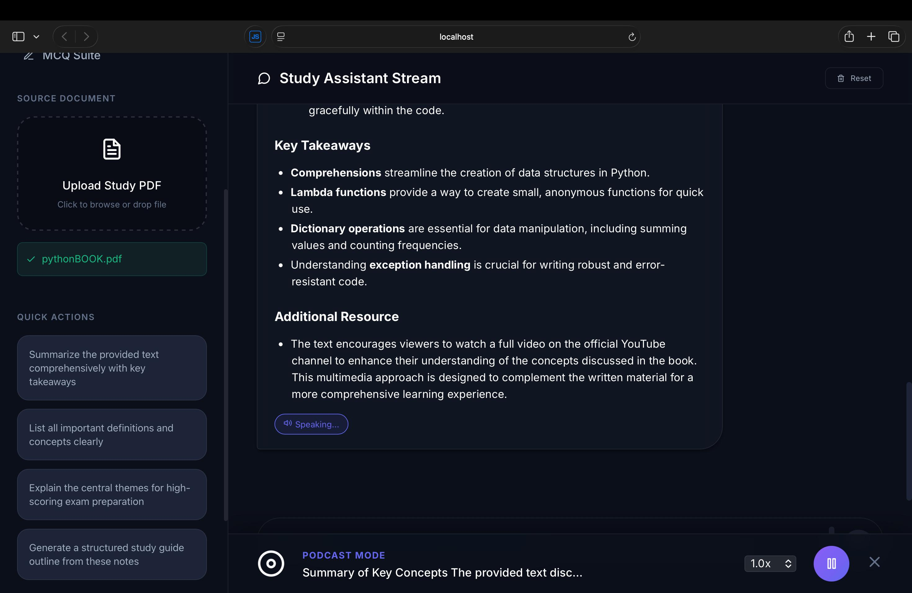

# StudyBuddy

StudyBuddy is an AI-powered study assistant that helps students learn from PDF notes. Users can upload a study PDF, ask questions about the document, generate flashcards, and create a short MCQ test from the uploaded material.

The project is split into a FastAPI backend for PDF processing and OpenAI-powered generation, plus a React frontend for the study dashboard experience.

## Screenshots

### Study Assistant Dashboard



### AI-Generated Study Answer with Podcast Mode



### Interactive Flashcards


## Features

- PDF text extraction using PyMuPDF
- Question answering over uploaded study material
- Retrieval flow that splits PDF text into chunks, embeds them, and selects the most relevant chunks for an answer
- AI-generated flashcards from a PDF or the latest study context
- AI-generated 5-question MCQ test from uploaded notes
- Interactive flashcard review screen
- MCQ test screen with scoring and answer review
- Chat-style study assistant interface
- Recent chat history saved in browser local storage
- Browser voice input through the Web Speech API
- Text-to-speech playback for generated answers

## Tech Stack

### Frontend

- React
- React Router
- React Markdown
- React Icons
- Create React App

### Backend

- FastAPI
- Uvicorn
- OpenAI API
- PyMuPDF
- NumPy
- python-dotenv

## Project Structure

```text
StudyBuddy/
|-- backend/
|   |-- main.py
|   |-- requirements.txt
|   `-- utils/
|       |-- PdfTextExtractor.py
|       |-- embedding_generator.py
|       |-- retriever.py
|       `-- text_splitter.py
|-- frontend/
|   |-- package.json
|   `-- src/
|       |-- App.jsx
|       `-- components/
|           |-- ChatArea.jsx
|           |-- DashboardLayout.jsx
|           |-- FlashcardsView.jsx
|           `-- McqTestView.jsx
`-- README.md
```

## How It Works

1. The user uploads a PDF study document from the frontend.
2. The backend extracts text from the PDF.
3. The text is split into smaller chunks.
4. OpenAI embeddings are generated for the chunks and the user's query.
5. The most relevant chunks are selected with cosine similarity.
6. The selected context is sent to an OpenAI chat model to generate a structured answer.
7. The same backend also supports flashcard and MCQ generation from study content.

## Backend API

| Method | Endpoint | Purpose |
| --- | --- | --- |
| POST | `/upload` | Upload a PDF with a query and receive an AI-generated answer based on relevant chunks |
| POST | `/generate-flashcards` | Generate 5-10 flashcards from an uploaded PDF or provided text |
| POST | `/generate-test` | Generate a 5-question MCQ test from an uploaded PDF |

## Getting Started

### Prerequisites

- Python 3.10+
- Node.js and npm
- OpenAI API key

### Backend Setup

```bash
cd backend
python -m venv venv
source venv/bin/activate
pip install -r requirements.txt
```

Create a `.env` file inside the `backend` folder:

```env
OPENAI_API_KEY=your_openai_api_key_here
```

Start the backend server:

```bash
uvicorn main:app --reload
```

The backend runs at:

```text
http://localhost:8000
```

### Frontend Setup

Open a second terminal:

```bash
cd frontend
npm install
npm start
```

The frontend runs at:

```text
http://localhost:3000
```

## Notes

- The frontend currently calls the backend at `http://localhost:8000`.
- Generated answers, flashcards, and tests depend on the quality and readability of the uploaded PDF text.
- Browser voice input requires Web Speech API support, which works best in Chrome-based browsers.

## Future Improvements

- Add user authentication and saved study sessions
- Store uploaded documents and generated study materials in a database
- Add export options for flashcards and MCQ results
- Add deployment configuration for the frontend and backend
